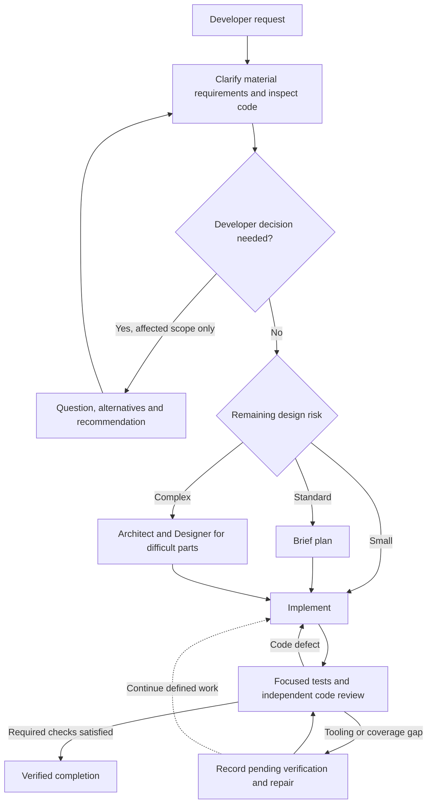

# AL operating contract and logical flow

AL should improve specification clarity, implementation, tests and code review
while keeping the workflow proportionate to the change. Its own bookkeeping,
tooling or discovery limitations must not become developer approval questions.

The diagram describes the target control flow. Each installed run retains its
actual versioned runtime; updating AL does not silently rewrite an old pin.

## Questions and routing

Ask about material behavior, scope and consequential engineering choices that
need the developer. Inspect existing code to resolve ordinary implementation
details. Preserve approved requirements and accepted amendments; do not repeat
the interview just because a tool or internal report failed.

Use the lightest route justified by the remaining design risk. Small established
patterns need focused implementation, tests and independent review. Ordinary
features need a brief useful plan. Add architecture or pseudocode for a specific
difficult design problem where it reduces risk. Repository size, file count,
security keywords and tooling failures do not justify escalation.

## Implementation and verification

Missing tools, incomplete service/check discovery, unsupported repository forms,
provider failures and pending proof create operational repair work. Keep the
diagnostics, repair within existing authorization, and continue defined scoped
implementation. Internal reassessment and retry budgets preserve history without
becoming developer approval requirements or preventing ordinary authorized edits.

Useful authored output can unblock a dependent implementation task before its
producer is verified Completed. Changing that output invalidates dependent
readiness. Code defects return to focused repair; unavailable checks remain
explicitly pending. Final approval and verified completion require current,
relevant evidence. Unknown, missing, stale and failing checks never count as
passes.

Real execution authority, current invocation and epoch identity, ownership,
secrets, safe paths and process containment apply throughout. A physically
unavailable operation receives a technical diagnostic and repair action, with
independent authorized work continuing. Never ask a native agent to grant itself
privileges or fabricate authority to keep a workflow moving.

## Recovery and visible status

Supported recovery preserves the original approval, accepted requirement lineage,
decisions and failure history. A prepared successor grants no product authority.
Activation selects exactly one runtime; stale agents, worker callbacks, events
and decisions cannot mutate the successor. Terminal agents require fresh observed
invocations. Preparation and activation do not implicitly resume native work.

The dashboard distinguishes implementation progress, developer decisions,
technical repair and verification. Pending checks have no developer decision
form. Previous runtime history remains visible without transferring its evidence
or approvals into the current run. Already approved specifications are presented
as approved, with execution progress separate from spec approval.

## Code review contexts

The review stage uses two separate Architect invocations. Both receive the full
original specification and accepted amendments. The fresh invocation inspects
the selected diff, code, tests and evidence without the plan, pseudocode or
implementer's summary. The comparison invocation then receives those design
inputs and the fresh findings to check implementation alignment and resolutions.
The diagram groups these invocations into one logical review stage; it does not
remove either review or review the code without its requirements.

## Regression requirements

- A defined scoped task can author code while coverage and proof are incomplete;
  the missing obligations persist and final approval stays unavailable.
- Tool/provider failures create operational issues, without developer questions
  or blocking independent implementation.
- A genuine specification or developer engineering choice pauses only its
  affected work.
- Internal reassessment/budget status alone cannot reject an authorized writer,
  and no counter or historical decision is rewritten to simulate permission.
- Simple work avoids unnecessary design stages, repeated interviews and manual
  reconstruction of report metadata. Agent reuse and generated handoffs reduce
  orchestration work.
- Real managed-start, containment, interrupted recovery, replay and stale-epoch
  tests preserve the authority and secret boundaries.
- Terminal, JSON/report and dashboard outputs agree about implementation,
  verification and completion. Dashboard updates preserve scroll, disclosures
  and drafts within an identity and reject delayed responses across identities.
