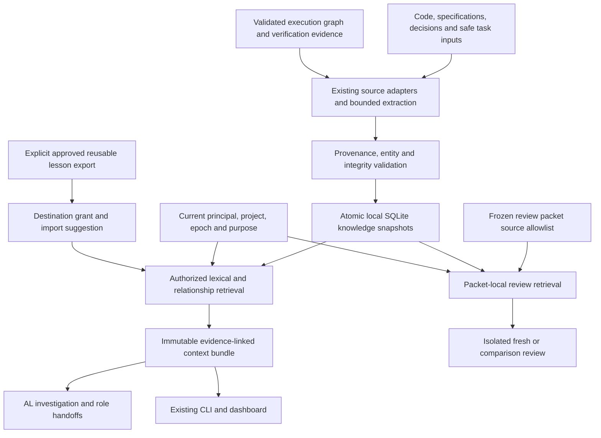

# Unified Knowledge & Context Intelligence Platform

Status: proposed for explicit developer approval; no implementation authorized.
Harness task: `t-ab980907`; AL planning session: `knowledge-platform-20261116`.
Original scope: [mission.md](mission.md). Source investigation: [investigation.md](investigation.md).
This proposal incorporates the actual read-only AL-Architect assessment.

## Recommendation and alternatives

Extend the existing per-repository SQLite database with a derived knowledge
projection, typed relationships, indexed lexical search and bounded graph
retrieval. Keep Git-versioned Markdown specifications/decisions and existing
approval/evidence receipts authoritative. Reuse stdlib SQLite and numbered SQL
migrations; add no database service, ORM, embedding provider or background daemon.

| Approach | Fit and tradeoff | Decision proposed |
| --- | --- | --- |
| Existing SQLite plus sourced assertions and lexical/graph retrieval | Matches the local product, supports transactional publication and explainable evidence paths; lexical retrieval has paraphrase limitations | Recommended foundation |
| Vector-first memory | Helps paraphrase recall but cannot establish identity, approval, freshness or scope; introduces model, privacy and re-embedding lifecycle | Defer; later optional candidate generation must demonstrate benefit against the same evaluation |
| External graph/vector service or full community-summary GraphRAG pipeline | May suit centralized organizational scale; introduces deployment, credentials, tenancy, network dependence and derived-summary invalidation | Defer until measured scale or collaboration requirements justify it |

The recommendation follows [DEC-0003](../decisions/DEC-0003-sqlite-access.md)
and [SPEC §6](../SPEC.md). Research supports SQLite
[full-text retrieval](https://www.sqlite.org/fts5.html) and
[bounded relationship traversal](https://www.sqlite.org/lang_with.html).
[GraphRAG](https://microsoft.github.io/graphrag/) informs the alternatives;
its reported benchmark improvements are not claimed for Harness.

## Components

One `harness/knowledge/` service supplies shared source, entity, assertion,
snapshot, policy and context-bundle contracts. It adapts existing repository
investigation, decision history, requirement identities, effective design models,
task checkpoints and validated execution entities/edges. The operational
execution graph remains authoritative for execution; the knowledge projection
references its existing IDs rather than replacing it.

The service contains focused modules for models, persistence, source adapters,
extraction, refresh, policy, retrieval and explanations. Existing CLI, dashboard,
guarded MCP dispatcher and AL packet/handoff builders are consumers. No separate
agent memory store is introduced.

## Responsibilities

The source adapters reuse `parse_decision`, decision history, the accepted
requirement registry, task events/checkpoints, the design model and validated
execution events. They preserve source status, version, identity and boundaries.
The knowledge service stores derived observations and relationships; it does not
resolve developer decisions or manufacture current verification results.

AL-Engineer owns the correctness-sensitive storage, extraction, snapshot,
retrieval, policy and packet integration. AL-Builder follows after contracts
stabilize to complete presentation, fixtures, documentation and broad verification.
There are no parallel writers initially: support work consumes the new contracts.
AL-Architect performs independent fresh review and then comparison review through
the existing runtime. A targeted Designer pass specifies the new snapshot and
information-flow protocols before implementation.

## Interactions

Existing Harness investigation coordinates local indexing and records its selected
context bundle alongside the investigation checkpoint. Pure `analyze()` remains
read-only and existing callers remain compatible. Role handoffs retrieve context
from the same service through supervised project/task bindings. Knowledge failures
are operational diagnostics; independently defined authorized implementation
continues while verification obligations remain visible.

New closed MCP query/explanation tools pass through `OperationController`, the
current principal and execution authority. The server derives project, task,
epoch, role and purpose; request text cannot supply its own authority. Read-only
agents contribute source-bound named reports through their permitted outbox.
The supervisor validates and ingests them as attributed assertions, not approvals.

Review retrieval uses a packet-local source projection. Fresh review cannot query
the general project corpus and merely filter its final answers. Its permitted
sources exclude the plan, pseudocode, implementer reports and prior findings,
including indirect derivations through aliases, merges, summaries or caches.
Comparison retrieval uses its separately issued permitted set only when the
existing workflow admits comparison. Candidate selection, ranking and aggregate
counts must not depend on forbidden source material.

## Data flow and lifecycle

A source version records repository identity, confined locator, content hash,
source kind, source span, extractor version, immutable commit or working-tree
observation, extraction status and visibility. Runtime sources additionally cite
task, execution, epoch and event/evidence identities. An assertion records subject,
predicate, object/value, evidence references, derivation parents, applicability,
origin and verification state. Authority, confidence and freshness are separate:
recent indexing does not make a claim current, and confidence cannot create
approval. An approved status in a source document is recorded as a source-backed
status, not a newly granted AL approval.

Deterministic adapters extract structured decision/requirement/design/execution
relations. Python AST analysis handles definitions, imports and resolvable static
references without executing source. Existing manifests and literal relative
imports are reused. Unstructured prose supplies text and explicit references;
semantic interpretation remains attributed inference. Unsupported languages,
dynamic imports and ambiguous calls expose coverage gaps rather than precise
invented dependencies.

Entity resolution prefers explicit scoped identities: decision ID/version,
task/execution/epoch, requirement source, module-qualified symbol and source
identity. Aliases are scoped/versioned; ambiguity returns alternatives, never an
automatic fuzzy merge. Repeated contributions are idempotent. Concrete conflicts
include incompatible values for declared single-valued predicates within the
same applicability, conflicting current decision versions, unresolved identity and
broken evidence. Natural-language contradiction detection remains inference.

Refresh extracts outside the write transaction, reuses unchanged content-addressed
outputs, and atomically publishes assertions, membership, lexical updates, source
cursor and active snapshot in a short transaction. Changed extractor versions
invalidate their outputs. Failed publication never advances the active pointer.
Immutable Git objects provide commit snapshots. Working-tree reads retain and
revalidate file/inventory observations; instability is explicitly incomplete,
not presented as an atomic repository revision.

Only complete enumeration can establish deletion. Unreadable/capped sources are
unknown. Tombstones and historical snapshot membership preserve evolution.
Renames require unambiguous supporting evidence; otherwise they are proposed
aliases. Branch identity and commit ancestry prevent timestamp-only freshness.
Selected current citations are revalidated before bundle publication; whole-graph
coverage remains separately described so new consumers cannot silently be ruled
out by old snapshots.

Impact analysis follows typed reverse dependencies and relevant decision and
requirement links, returning explanatory paths and their evidence. Static imports
support likely source impact, not guaranteed runtime behavior. Validated execution
events/evidence are referenced with their existing IDs. Knowledge never turns an
old PASS into a current valid PASS or erases an earlier failed receipt.

## Interfaces

`ContextRequest` supplies query text, optional entity references, optional as-of
snapshot and bounded limits. Server-side context supplies the authorized project,
principal, task/epoch, purpose and permitted sources. `ContextBundle` records an
immutable hash, schema version, snapshot, policy/purpose digest, query, assertions,
source spans, relationship paths, ambiguity/conflict/staleness observations,
coverage gaps and budget/truncation metadata.

Query sequence: verify current identity/purpose; restrict sources; match explicit
IDs and lexical candidates; expand supported relationships within that partition;
separate current/history/inference/conflicts; rank deterministically by relevance
and explanatory paths; pack the bounded bundle; recheck policy and selected
evidence; publish the immutable bytes/hash. Cross-purpose authorization and source
restrictions propagate transitively through derivations and caches.

Native `harness knowledge inspect/query/explain` and guarded query/explanation
tools expose the same service. Refresh and source-bound contribution use closed
operator/supervisor-controlled interfaces. AL handoffs carry bundle references;
both mirrored platforms receive consistent contract updates. Old pinned AL runs
retain their original runtime; supported upgrades do not rewrite history.

The existing dashboard gains context search, a bounded selected relationship
subgraph, provenance explanations, history, integrity observations and coverage.
It explains why each item was selected and renders source text literally.
Knowledge diagrams remain distinguishable from accepted architecture diagrams.

## Configuration, privacy and compatibility

Initial retrieval limits are 32 KiB per bundle, 40 assertions, two relationship
hops and 200 examined edges. Limits and exclusions are visible in results. Timing,
index size and cold-versus-warm costs are measured rather than represented by
unverified service-level promises. Native host token accounting is used when
available; otherwise byte counts are reported honestly.

The existing explicit Harness invocation activates local project work; no daemon,
automatic neighbor-repository scan, external upload or dashboard feature flag is
added. Default sources are eligible tracked text, explicit task inputs and selected
structured Harness records. Untracked sources require task-scoped inclusion.
Raw transcripts, operation arguments/stdout, credential stores, raw environment
values and arbitrary diagnostic logs are excluded. `.env.example` is not an
automatic exception. Source descriptors enforce confinement, regular-file and
size limits, symlink/hardlink restrictions and protected/secret exclusions.

The current private local SQLite location and permissions remain. Unpinned
derived excerpts/query caches have a proposed 30-day retention; active and
execution/review-pinned bundles retain their referenced lifecycle. Important
hashes, spans, provenance and history persist without unnecessarily copying whole
confidential files. Knowledge purge removes derived payloads, invalidates affected
bundles and retains content-free purge metadata; it does not delete authoritative
execution records. Revoked access is enforced on every query/explanation, including
cache reads. Revocation cannot retract information already deliberately disclosed.

Cross-project reuse requires explicit exact-content approval of a portable lesson
and an explicit source/destination/material grant. Exported Git Markdown includes
applicability, rationale, limitations, version, disclosure-safe evidence and
approval provenance. Private traces do not travel. Destination import is a
suggestion until its own decision workflow adopts it. Grants are non-transitive;
revocation invalidates future access and cached bundles.

The next additive migration, currently `0015_knowledge.sql`, creates projection
schema only. It does not index repositories or backfill history during startup
migration. Indexing runs in bounded batches outside migration transactions.
Existing task, decision, approval, execution and command behavior remains valid.
Source/permission-policy changes invalidate affected context; no existing
approval or runtime pin is silently upgraded.

## Failure handling and operational prerequisites

Failed extraction/publication retains the last complete snapshot and exposes
the failed/incomplete coverage. Unsupported sources, stale evidence, ambiguous
identity, source removal, empty results and exceeded budgets have distinct visible
outcomes. No-result is never proof of no dependency. Missing context does not
create a product-design question or override execution admission.

Context receipts record snapshot and policy, selected sources, limits, source
read counts, timing and integrity observations. They avoid logging confidential
query/source contents unnecessarily. Existing local dashboard/CLI diagnostics
surface failures; no new external alerting system is introduced.

The installed interpreter has SQLite 3.50.4 with FTS5. The
[official WAL advisory](https://www.sqlite.org/wal.html#walreset) documents a
concurrency race affecting that build. Before migration/concurrency demonstrations,
use a supported patched stdlib SQLite build (3.51.3+ or an identified fixed
backport, with required capabilities). This is an operational runtime repair,
not a request to choose another database or weaken validation. Both CI platforms
must prove their actual SQLite and FTS5 capabilities.

Repository CI includes Linux/macOS Harness checks, containment, browser and full
AL verification. No job-level timeout or production/staging pilot deployment was
found in product workflows. Effective provider/administrative time limits remain
a verification prerequisite; fixture GitLab settings are not this deployment.
Index backfill must not hold write locks while reading source or calling agents.

## Delivery increments

1. **Persistent sourced context:** source/version/assertion contracts, additive
   schema, decision/requirement/design/code adapters, lexical/relationship query,
   source explanations, native investigation and Architect context use. Demonstrate
   architectural understanding, decision recall and retrieval in a later invocation.
2. **Evolution and agent integration:** incremental snapshots, history/deletion/
   rename/branch handling, aliases/conflicts, impact paths, attributed agent
   contributions, guarded MCP/handoffs and fresh/comparison isolation. Demonstrate
   a fresh session and cross-agent transfer in a later task.
3. **Reusable lessons and measured delivery:** approved cross-project transfer,
   dashboard exploration, documentation and all seven native demonstrations, with
   the held-out baseline evaluation and complete AL tests/reviews.

Each increment must function inside Harness. Increment completion or isolated
component tests do not by themselves complete the mission. The future reliability
engine is excluded; typed links to existing agents/events/evidence/source versions
provide its extension points without an autonomous improvement loop.

## Acceptance and evaluation

K1–K7 are the mission's seven success scenarios. K8 requires functioning native
investigation, approvals, handoffs, tools, two-stage review and UI integration.
K9 requires persistent provenance/history and typed future reliability links.
Execution authority, project isolation, human approval, provenance and existing
failed evidence are invariants, not optional ranking features.

Freeze 12–16 held-out paired tasks before retrieval tuning, using this repository
and a disposable second project. Baseline uses current `analyze()`, decision
registry/history, `decision_suggest` and normal source inspection. Candidate uses
the same revision, task, role/model and budget with knowledge enabled. Separate
tuning examples; randomize paired order and use fresh sessions. Label supporting
sources and likely impacted components independently before scoring.

Measure supported-claim precision, relevant evidence recall, impact recall, correct
decision/version/rationale recovery, source reads/bytes, available token counts,
time to an acceptable sourced explanation, and integrity/isolation violations.
Report cold-index cost, warm-query cost, write-lock time and storage separately.
Proposed release criterion: zero demonstrated authority/isolation/integrity
violations; no material reduction in sourced correctness; and at least one
meaningful improvement, such as a 20% median reduction in source reads/context
bytes on eligible paired tasks or improved impact recall at comparable supported
precision. Report individual results and variance, including regressions.

Actual AL invocations must demonstrate architecture explanation, decision recall,
fresh-session continuity, impact analysis, discovery transfer between specialized
agents in a later task, stale/conflict/supersession handling and the measured
comparison. Keep actual agent IDs, task IDs, bundle hashes and source-backed
outputs. Scripted MCP/subprocess fixtures verify contracts but do not establish
actual native collaboration or business acceptance.

Focused tests cover persistence/migration/restart; atomic publication and failure
recovery; source lifecycle; extraction/identity precision; budgets; forged/stale/
revoked capabilities; prohibited review-context canaries; approval/evidence
preservation; cross-project transfer and revocation. Chrome verifies desktop and
narrow views, source links, keyboard/focus/scroll stability, literal rendering,
misalignment and graph usability. Existing Harness regressions, packaging, AL
platform parity/full verification and acceptance remain required for changed scope.

## Approval requested

Approve this proposed architecture, extraction/trust model, isolated retrieval,
explicit cross-project lesson reuse and three-increment evaluation plan. Approval
will be recorded through the exact Harness review package; existing final
specification and implementation approval gates remain distinct. No proposal in
this document is recorded as an approved decision yet.
