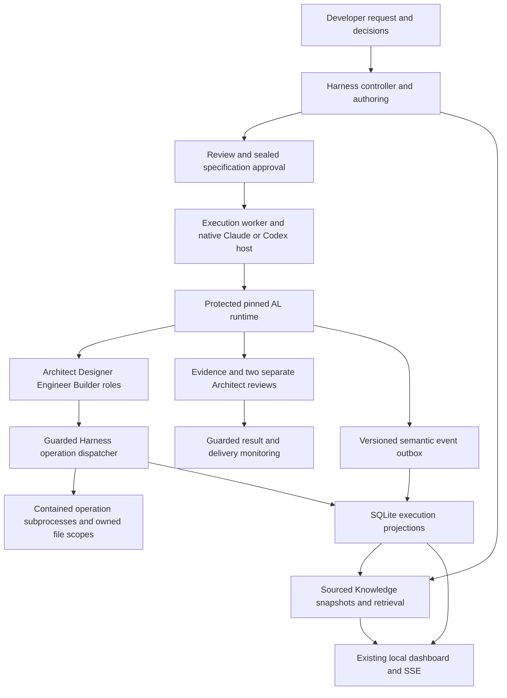

# Harness reliability architecture audit

> Status update: P1–P5 are now accepted as DEC-0048–DEC-0052. See [approved status and current evidence](approved-status.md); pending statements below describe the original audit checkpoint.
The repository already provides a substantial engineering governance and execution platform. The main missing capability is the controlled chain from a runtime failure to an incident, an evaluated improvement, an approved rollout and evidence of its effect. Extend the current system; retain AL orchestration, local SQLite, the existing dashboard and the sourced Knowledge projection.

This is the requested Phase 0 delivery. Product implementation awaits the architectural choices in [the design and roadmap](design-roadmap.md). The unchanged user mission is retained in [original-mission.txt](original-mission.txt). No production readiness or formal AL completion is claimed.

## Scope and evidence

- Audit date: 19 November 2026, Europe/Berlin.
- Source baseline: `2ad8bed9bdcaf82212f5f5ab3c8585b79943ca9d`, local `main` when the worktree was created. No remote refresh or claim about later changes.
- Isolated branch: `codex/reliability-platform-audit`; worktree `/Users/alirezaghiastabari/.codex/worktrees/reliability-platform-audit/myharness`.
- Clean source baseline; no source, test, migration, agent instruction or authority changes during this audit. Deliverables are documentation and pending local proposals.
- AL session `reliability-audit-20261119` retains the immutable task package. Named AL Architect and three read-only Scouts inspected execution/policy, observability/dashboard and knowledge/reliability. The Architect verified substantive leads. No implementer or Designer was dispatched.
- [Capability inventory](capability-inventory.md) classifies mission requirements. [Verification](verification.md) distinguishes source findings, executed fixture checks, failed attempts and unperformed native/Chrome acceptance.
- The database reference was read. Investigation used repository SQL schemas and disposable fixture databases, with no external database or Atlassian access.

## Current architecture

The diagram separates observation and authority: events and retrieved knowledge describe evidence; AL admission and the current approved specification authorize work.

| Investigation area | Existing implementation and file evidence | Assessment |
| --- | --- | --- |
| Orchestrator and role ownership | `al/codex/skills/al/SKILL.md`; `al/codex/agents/`; `al/claude/agents/`; `al/codex/skills/al/scripts/al_phases.py`, `al_writers.py`, `al_review.py` | Implemented with risk-based Small/Standard/Complex routing and fixed role policies; source and installed immutable runtimes are separate versions. |
| Architect and Designer | Named read-only role profiles; `al_planning.py`, `al_planning_attempts.py`, `al_routing.py` | Planning and difficult-design review exist. Two distinct review invocations preserve fresh-review context separation. |
| Engineer and Builder | Writer admission, owned paths, handoff generation and evidence under `al_writers.py`, `al_writer_handoff.py`, `al_implementation.py` | Existing execution path to strengthen; no new scheduler is needed. |
| Requirements, decisions and approvals | `harness/interview.py:51`, `design.py:23`, `review.py:27`, `approval.py:76`, `decision_workflow.py:102` | Versioned decisions, human proposal verdicts, review completeness and sealed spec binding exist. |
| Runtime enforcement | `execution_operations.py:235`, `execution_authority.py:18`, `execution_files.py:216`, `execution_isolation.py:230`, `native_tool_policy.py:125` | Real guarded paths and containment exist; no single configurable hierarchy covering every requested policy/budget. |
| Testing and release | `.github/workflows/ci.yml`, `containment.yml`, `browser.yml`, `al-release.yml`; `al/release_verify.py`, `al/verification-obligations.json` | Linux/macOS PR checks plus separate containment/browser/release tiers. Presence of a job does not establish current execution success. |
| Persistence | `harness/db.py:45`, `:92`, `harness/migrations/0001_tasks.sql` through `0018_authoring.sql` | Local per-repository SQLite/WAL; numbered migrations; Git Markdown specs and decisions; protected pinned AL state/artifacts. |
| Knowledge and graph | `knowledge/models.py:42`, `adapters.py:154`, `query.py:593`, migrations `0015_knowledge.sql`, `0016_knowledge_index.sql` | Existing sourced assertions, evidence, derivations, snapshots, FTS and bounded traversal; reuse rather than duplicate. |
| Dashboard and interfaces | `harness/dashboard/server.py:118`, `:288`; `dashboard/static/execution.js`, `knowledge.js` | One stdlib HTTP/SSE application with execution and Knowledge panels. Reliability views are missing. |
| Observability and failure handling | `execution_contract.py:8`, `execution_projection.py:239`, `execution_operations.py:377`, `execution_logs.py:145`, `native_diagnostics.py:1` | Semantic events, real operation audits and fixed native diagnostics exist; uniform privacy-safe traces and incidents do not. |
| Providers | `execution_hosts.py:146`, `native_runtime.py:25`, `native_tool_policy.py:125`, `native_diagnostics.py:75` | Claude and Codex CLI adapters; explicit host qualification. Custom Codex provider selection refuses without verified profile. General capability/usage/cost interface is missing. |
| Instructions and mirrors | `.claude/commands/harness.md`; `al/{codex,claude}/skills/al/`; `al/release-layout.json`; agent profiles and parity tests | Deliberate platform distribution mirrors. Changes must preserve release/parity constraints; do not consolidate them casually. No checked-in applicable `AGENTS.md` or `CLAUDE.md` was found; the chat-supplied AGENTS instructions govern this task. |

## Integration and security findings

**The prior Knowledge mission remains unfinished.** `docs/knowledge/recovery-20261119.md:114` leaves K1–K9 demonstrations open and states Reliability/Self-Improvement is outside that mission until Knowledge acceptance. The older November 16 status underestimates later source integration. Conversely, newer source does not establish native acceptance. The roadmap preserves this dependency unless the developer explicitly approves a narrow sequencing amendment.

**Runtime authority is stronger than prompts, within defined paths.** `execution_authority.py:18` rechecks current immutable approval; `execution_decisions.py:164` scopes decision delivery; `execution_epochs.py:25` rejects stale generations. `OperationController` authorizes actual tools and uses operation isolation. `execution_isolation.py:243` explicitly leaves native authentication infrastructure outside the operation tree. Codex native profiles request a read-only sandbox (`native_tool_policy.py:145`); Claude uses generated permissions/hooks. The native worker starts its host process directly (`execution_worker.py:792`). Helper `prepare_isolation()` and `execution_network.provider_transport()` are not evidence of production-wide host/proxy containment: their inspected call sites are tests. No guarantee against a compromised native host, provider or same-user operator follows from these controls.

**Two privacy gaps require regressions before telemetry expansion.** The dispatch exception branch writes `str(error)[:2048]` directly into `operation_audit` (`execution_operations.py:433`), while requests and successful results use redaction. The semantic event importer validates then canonicalizes/persists the original payload (`execution_projection.py:269`). Text-bearing payloads therefore lack a uniform pre-persistence privacy projection. These are source-backed findings, not reproduced secret leaks. Existing immutable event identities must not be silently rewritten to retrofit redaction.

**The native observation restrictions are intentional.** `scripts/knowledge_evaluation/observer.py:1`, `usage.py:34`, and `docs/knowledge/recovery-20261119.md:19` retain qualified-observer refusals, unknown generation usage and donor restrictions. Do not read private provider transcripts to fill observability gaps, hash private material for correlation, or turn missing usage into zero cost.

**No persistent incident or improvement control plane was found.** The migration inventory contains execution events, issues, decisions, logs, lessons and grants, but no complete incident/root-cause revision model, improvement proposal registry, engineering benchmark registry or promotion/canary/rollback lifecycle. This negative finding is bounded to the inspected tracked source, all numbered migrations, `harness/knowledge/`, execution modules, evaluation scripts and both AL packages. Existing operational issues and lesson suggestions are related evidence, not substitutes for that lifecycle.

**Replay and evaluation have useful foundations with different guarantees.** AL public-command replay uses disposable repositories and explicitly reports simulations (`al/codex/skills/al/scripts/al_replay.py:60`). Knowledge accounting compares bytes and qualified fields (`scripts/knowledge_eval.py:150`), without proving engineering outcome quality. Neither is a general historical incident replay/evaluation lab.

**Current runtime prerequisite fails.** The selected interpreter links SQLite 3.50.4. Running the existing `tests/test_sqlite_capabilities.py` produced 5 passes and 1 failure: the repository requires ≥3.51.3 or an explicitly sourced fixed backport (none allowlisted). No alternate compliant Python 3.13 installation appeared in `uv python list --only-installed`. This is an operational test-environment obligation before future database/concurrency qualification; the representative fixture passes do not satisfy it. No requirement or assertion was relaxed.

## Engineering risks

| Risk or conflict | Required treatment |
| --- | --- |
| Duplicate memory, workflow or dashboard architecture | Use existing Knowledge source IDs and operation/execution authority. Add projections and views to current services. |
| Existing source event hashes versus privacy transformations | Preserve the authority event contract; produce a separate closed observation schema at its producer boundary. Reject unsafe new events before persistence, with explicit compatibility behavior. |
| SQLite and external process crash windows | Atomic DB publication where possible; durable intents and idempotent reconciliation for cross-store/process steps; do not claim arbitrary side effects can roll back. |
| Concurrent agents overspending shared budgets | Central durable reservation/consumption and inherited root caps; a child cannot gain budget by delegation. Requires later protocol design and tests. |
| Repeated failure becoming a permanent rule | Separate observations, hypotheses, proposal revisions, independent evaluation, approval and version activation. |
| Fresh review contamination | Keep packet-local allowlists and current native refusal; general project knowledge cannot flow into a clean-review context. |
| Local dashboard assumptions | Preserve DEC-0016 local developer scope. Remote tenancy/authentication would require a separate approved design. |
| Hidden worktree and interpreter paths | The operation sandbox hides the user's `.codex` tree. An interpreter inside a managed `.codex/worktrees` checkout cannot establish operation capability; use a separately installed locked test environment without weakening hidden-root policy. |
| Historical prose overstating current readiness | Use source and current check receipts; retain old reports as historical. Current local checks do not prove hosted CI, native provider entitlement or Knowledge acceptance. |

## Delivery boundary

Implemented now: this source-backed audit, proposed architecture/roadmap, capability inventory, verification record and pending approval proposals. No reliability feature, migration, runtime policy, observer qualification or promotion behavior was implemented. The next action is the concrete architectural decision checkpoint in [design-roadmap.md](design-roadmap.md).
