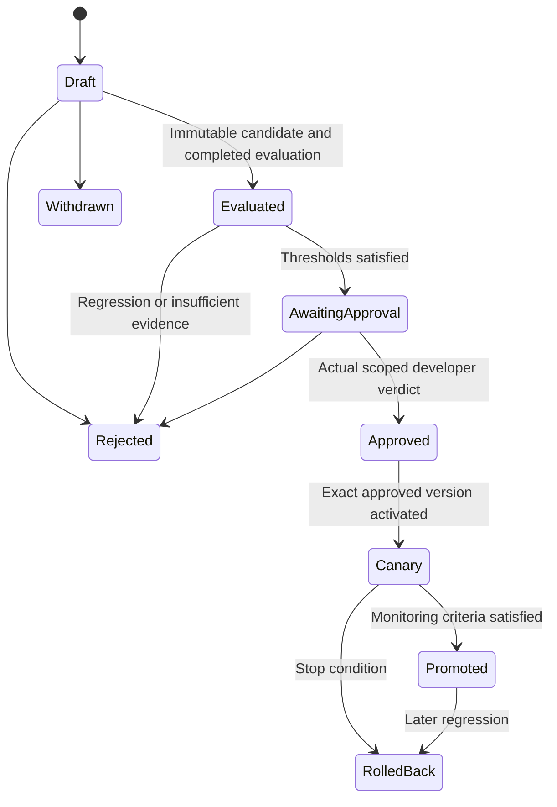
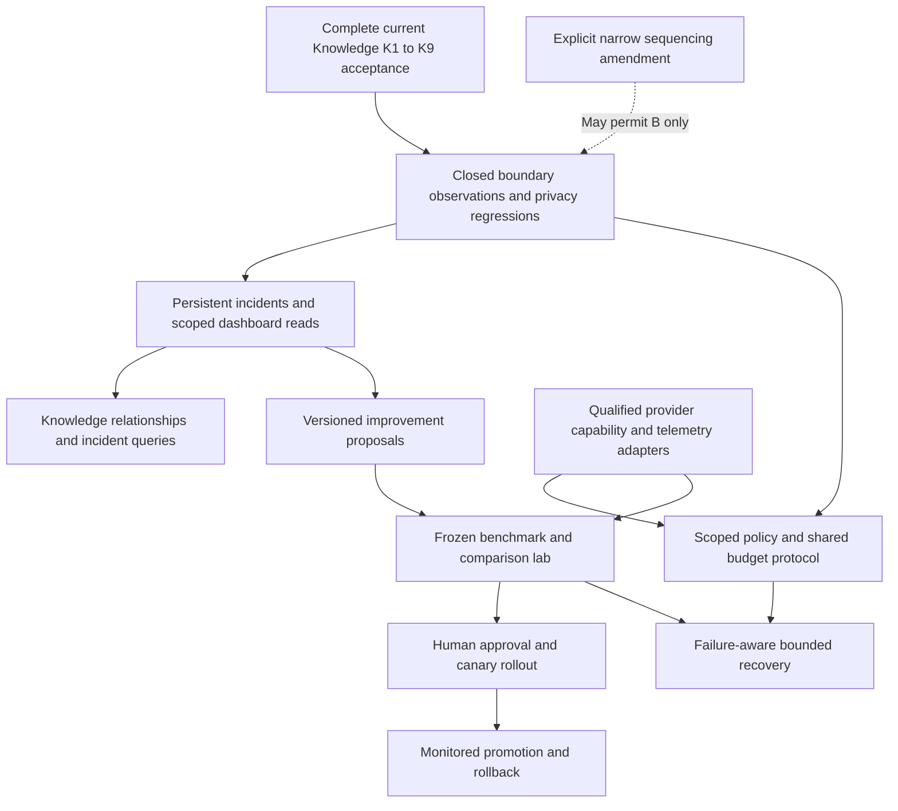

# Reliability platform design and implementation roadmap

> Status update: P1–P5 are now accepted as DEC-0048–DEC-0052. See [approved status and current evidence](approved-status.md); pending statements below describe the original audit checkpoint.
Extend the existing control plane with closed boundary observations, persistent incidents, evaluated improvement proposals and monitored version activation. These are proposed changes. Existing Python/stdlib SQLite, Git decision/spec records, native Claude/Codex adapters, AL approval gates, Knowledge projection and local dashboard remain the foundation.

## Component ownership

| Component | Owns | Integrates with |
| --- | --- | --- |
| Boundary observations | Actual operation/process/policy/approval/check outcomes; correlation and privacy projection | `OperationController.dispatch`, execution worker, AL evidence handlers and current approval gate |
| Incident intelligence | Symptoms, classification, grouping suggestions, hypotheses, human corrections and resolution | Existing observation/artifact IDs, execution epochs and Knowledge adapters |
| Improvement registry | Candidate versions, ownership, measurable purpose, deduplication/consolidation/retirement, evaluation and rollback requirements | Existing developer decision workflow and future scoped AL implementation tasks |
| Evaluation lab | Frozen benchmark versions, independent outcome checks, paired comparisons and promotion eligibility | AL replay, existing knowledge accounting and actual evidence runners |
| Policy and recovery extensions | Composed permissions/budgets, bounded diagnosis/recovery, checkpoints and cancellation | Existing operation admission, subprocess containment, authority generations and AL recovery |
| Existing dashboard and Knowledge | Search/explanations, timelines, incident/proposal/evaluation projections and evidence links | Same database, HTTP/SSE application and sourced graph; no new memory or dashboard service |

Reliability may draft a change request. It cannot modify its own approval requirement, activate instructions or silently widen runtime authority.

## Proposed boundary contracts

All new boundary records use a closed versioned envelope. Required common fields are schema version, stable record/task/execution identities where applicable, source specification version, producer and provenance, required inputs, expected output references, acceptance criterion IDs, constraints, status/failure classification and evidence references. Validate at ingress and reject unsupported versions with actionable field errors. Existing Markdown remains readable through explicit adapters; never retroactively interpret prose as an approval token.

| Contract | Important payload and authority distinction |
| --- | --- |
| Requirement analysis | Source requirements, unresolved questions, facts versus assumptions; cannot change approved requirements |
| Architecture proposal and design decision | Alternatives, affected invariants, consequences, source version and pending developer verdict |
| Plan and assignment | Approved inputs, dependencies, role, owned paths, expected artifacts and acceptance IDs; actual admission still required |
| Implementation and verification result | Candidate/artifact hashes, actual check IDs/results, failures and limitations; process exit/progress is insufficient |
| Failure and escalation report | Closed observed outcome, failed controls, scoped affected tasks, hypothesis/evidence separation and requested decision |
| Final delivery report | Implemented criteria, current proof, outstanding obligations, material limits and actual acceptance outcome |

Extend current AL task-package, planning, handoff, authored-output, review and execution-event contracts where they already cover these concerns. Do not replace them with a redundant universal handoff service.

### Observation schema

Proposed `boundary-observation-v1` includes random `observation_id`, `trace_id`, `span_id`, `parent_span_id`, project/task/execution/epoch/principal/operation IDs, source reference, event kind, start/end timestamps, measured monotonic duration, closed outcome, policy/runtime/spec bindings and safe artifact references. Record observation provenance as `runtime_observed`, `validated_semantic_report`, `historical_import` or `simulation`.

Use one stable lineage trace with distinct epoch and attempt spans; retain original execution IDs. Every available measurement includes source and completeness. Provider/model, context limits, tokens and pricing-version cost are nullable/unknown unless qualified observations exist. Pin the pricing model with the run instead of applying current prices to history. Record harness/policy/spec/decision versions, retrieval bundle/evidence references, approvals, changed artifact references, validation outcomes and retries as typed links. Agent-owned narrative is never treated as observed activity.

The existing v1 semantic event sequence remains unchanged. Producer-side closed observations and an adapter connect existing events/audits to the new read model. Do not persist raw tool arguments, provider transcripts, secret-bearing error messages or their hashes. Redaction and allowlists run before persistence, indexing and export.

### Incidents and improvements

An incident has ID/revision, execution trace, category, observed symptoms, evidence, affected components, failed controls, related incidents, classification version, human corrections and resolution status. Hypotheses separately carry attributed author/model, confidence, supporting/refuting evidence and status. Deterministic exact-event keys prevent replay duplicates; similarity clustering suggests reversible relationships rather than merging distinct failures automatically.

A proposal has ID/version, incident evidence, change type, owner/scope, candidate artifact hash, measurable purpose/expected benefit, affected workflows, side effects, evaluation and rollback plans, approval requirements and state. Support all requested change types: instructions, validators, regression tests, permissions, contracts, retrieval, planning, orchestration/routing, observability and escalation. Prefer deterministic sensors/tests when they can detect the failure. Rules have owners, versions and retirement/consolidation relationships; no unlimited instruction-file append loop.

Proposed lifecycle:



Approval alone does not activate a version; activation rechecks the exact candidate, evidence, policy/epoch and rollout binding. Evaluation never approves a security change. Rollback restores a prior policy/package selection and preserves evidence; external side effects require their own idempotency/recovery procedure.

## Persistence and migration strategy

Use normalized tables in the existing per-repository SQLite database for observations, incident revisions/evidence links, proposal versions, benchmark versions, evaluation runs/results and rollout receipts. Reuse execution/epoch/artifact and approval references. Add a Knowledge source adapter for these records; retain operational authority in its original stores.

Choose the next migration number at implementation time; the audit baseline ends at `0018_authoring.sql`. Follow `harness/db.py` and existing WAL/foreign-key conventions. Keep startup changes schema-only; explicit bounded backfill records its source version, cursor, historical provenance and unavailable fields. Unique source keys and atomic projection/cursor commits provide idempotency. Cross-file/process publication uses durable intents and recover-forward reconciliation, with tests at each crash boundary. Do not fabricate historical spans or inherited PASS results. Legacy readers/pinned runtimes remain intact; unsupported new representations refuse explicitly.

## Policy and security design

Compose global, project, workflow, role and execution permissions by intersection. Any applicable explicit deny wins. More specific scopes can narrow permission; they cannot override a broader deny. Authorization-sensitive operations default to deny without current authority. Shared parent/child budgets use the tightest applicable cap and durable atomic reservations so subprocesses or delegates cannot reset limits.

Controls must address tool use, read/write scopes, structured command execution, network destinations, database targets, write counts, retry/time/token/cost budgets, production environments, required human approvals and delegation. Budget units and unknown measurements must be explicit. No claim of token/cost enforcement is valid until provider observations and a safe pre-admission bound are available.

Reuse current principal/epoch and operation authority. Approval capabilities bind the exact normalized operation/resource/scope, execution/epoch, spec and policy version, quantity, expiry and replay identity. Decision receipts retain developer provenance. Check before execution and emit the closed allow/deny result. Test alternate tools, wrappers, subprocesses, delegated agents, stale generations and direct provider paths against the stated supported boundary.

The current operation tree has OS containment; the native host's authentication infrastructure is a separate trusted boundary (`execution_isolation.py:243`). Full hostile-host isolation is a distinct design/qualification project. Keep observer refusals, credential selection and packet-local review separation. No external collector, semantic embedding service or remote dashboard is proposed for the initial slices.

## Evaluation methodology

Create immutable benchmark versions for feature work, bugs, refactors, APIs, database migrations, multi-file/architecture changes, ambiguity, tool failure, permissions, long runs, agent coordination and historical failures. Each case records task/environment inputs, deterministic criteria, allowed tools, policy, model/provider/capabilities, seed/order, baseline and candidate Harness versions, limits and provenance.

Hold model, task, tool/environment and sampling parameters fixed when isolating a Harness change. Pre-register thresholds before seeing results, use paired runs and independent quality review where required, separate public training incidents from held-out cases, and invalidate contaminated cohorts. Do not use agent confidence as success evidence.

Measure completion and criterion satisfaction, test/regression rate, policy violations, human interventions, retries/tool calls, duration, token/cost, recovery success and escalations. Report denominators, missing measurements and uncertainty; use only comparable coverage in historical comparisons. Exact replay needs reconstructed inputs/environment; otherwise report partial reproduction or simulation. Reuse AL replay for public-command simulation and knowledge accounting for its valid byte metrics; neither supplies missing native quality labels.

Promotion requires no demonstrated approval/isolation/privacy bypass, no material acceptance regression, a predefined improvement on the frozen comparison, independent review and a current developer approval. Begin with explicit approval for every activation. Canary compares agreed operational measures against stop conditions; failed/unknown qualification cannot promote.

## Dependency graph



A sequencing amendment does not waive K1–K9, qualify native observers, enable private transcript access, activate improvements or authorize adaptive recovery.

## Reviewable increments

| Increment | Dependencies | Complete acceptance and main risk |
| --- | --- | --- |
| R0 Preserve acceptance and privacy baseline | Architectural decisions; current Knowledge mission | Provision an interpreter meeting the existing SQLite capability requirement and rerun its check (current 3.50.4 fails), then finish K1–K9 and current native/browser/independent evaluations. Preserve fixed refusals; no invented observer evidence. Alternatively approve only the explicit narrow R1 sequencing amendment. |
| R1 One failure becomes an incident | R0 or narrow amendment | Public dispatch denial/failure produces one privacy-safe persisted incident, restart-safe scoped search/detail and current dashboard view. No forbidden side effect; duplicates/stale epochs/foreign scope/canaries tested. Cross-store crash and safe-schema risk. |
| R2 Lifecycle observations and Execution Explorer | R1 | Parent/child/epoch/tool/check/approval/retry spans with measured latency, evidence and availability-labelled usage; existing dashboard timeline and comparisons. Sensor completeness/privacy risk; no agent self-report substituted for observation. |
| R3 Typed gaps and composed policies | R1; qualified usage for token/cost caps | Extend missing handoff contracts, scope intersection, exact approval capability and durable shared budgets. Supported bypass/race/stale-child tests; policy version visible in decisions. Needs targeted Designer protocol work. |
| R4 Incident intelligence and graph | R1; Knowledge acceptance | Grouping suggestions, human corrections, failed-control/root-cause links and sourced incremental queries for all mission entity types. Preserve uncertainty, source limits and review context. |
| R5 Improvement registry | R4 | All ten change types, ownership/dedup/version/consolidation/retirement, evaluation/rollback requirements and immutable candidate. Proposal drafting never activates. |
| R6 General evaluation lab | R5; qualified provider measures where used | Versioned engineering registry, baseline/candidate paired outcomes, replay fidelity, held-out separation and predetermined regression thresholds. Reproducible deterministic evidence plus independent review. |
| R7 Approved rollout and rollback | R6; R3 | Exact-version approval, explicit activation, bounded canary, stop/rollback receipts and durable recovery at every window. Security/authority changes always require developer approval. |
| R8 Adaptive recovery | R3, R6, R7 | Diagnose/recover/escalate with inherited retry/cost/time limits, stagnation/identical-action detection, checkpoints/resume/cancel, idempotency and terminal report. No silent spec/architecture change. |
| R9 Provider and dashboard completion | Qualified native adapters; relevant earlier increments | Explicit capability matrix, normalized usage/cost/errors and cross-provider evaluations; complete all five reliability dashboard areas. Preserve Claude primary support and existing native auth. |

Every implementation increment uses AL against its concrete approved spec, focused/integration/security tests, current CI obligations and independent review. UI increments include desktop/narrow Chrome functional and visual alignment, overflow, focus, scroll and evidence-navigation checks. Hosted effective timeouts, per-environment rollout settings and native availability are verification inputs, never assumed from job presence. No Pub/Sub design is needed.

## First implementation slice

**A denied or failed supervised operation becomes a persistent, privacy-safe incident visible after restart in the current dashboard.**

Start with one deterministic category, such as an authorization denial. Capture at `OperationController.dispatch`, not an agent's optional report. An authorization failure already rejected before normal dispatch must still receive safe correlation without disclosing foreign execution details. Give every path a closed outcome, including pending/unknown crash outcomes. Reuse the active execution/epoch/principal and selected policy references. Keep full trace, proposal evaluation, cost accounting and autonomous recovery outside this slice.

Acceptance criteria:

1. A denied request has no prohibited side effect and produces a correctly scoped observation/incident.
2. Reprocessing the same source produces one observation and one incident; independent repeated failures remain separate observations with an optional grouping relation.
3. Restart or crash-window reconciliation preserves facts and leaves incomplete external outcomes explicitly unknown.
4. Synthetic secret canaries in arguments, rejected payloads and exception paths never enter new stored records, API/SSE exports, Knowledge projections or rendered text. Existing audit privacy paths receive regressions before expanding sensors.
5. Foreign task/execution and stale epoch requests cannot read or mutate another scope's records. Read-only dashboard routes start no work.
6. Existing event replay, spec approval, operation admission and native/Knowledge refusals remain authoritative.
7. List/detail/search results come from persisted state and retain category/evidence/provenance and hypothesis distinctions.
8. Desktop and narrow Chrome checks cover literal text, alignment, focus, keyboard/navigation, scrolling and overflow as well as function.

Engineer first owns contracts, dispatcher/store/classification/API and hard boundary tests. Builder follows once these interfaces are stable, completing UI, integration fixtures, documentation and check evidence. No parallel writers on changing contracts. The Architect reclassifies this specific slice after its approved details and security invariants are settled; the full mission size alone does not decide routing.

## Architectural decisions for the developer

These recommendations are staged as pending P1–P5 in dedicated Harness task `t-73243652`, mapped to RP1–RP5 in [pending-decisions.json](pending-decisions.json). No verdict, approved Decision Registry record, sealed specification, implementation approval or execution launch was created.

| ID | Concrete choice | Recommendation and alternatives |
| --- | --- | --- |
| RP1 | Can R1 precede unfinished Knowledge acceptance? | **Complete K1–K9 first.** Alternative: explicitly amend sequencing to allow only R1 boundary observations/incident/read UI now, preserving every existing qualification refusal and the remaining Knowledge acceptance debt. |
| RP2 | Who activates improvements? | **Automatically collect incidents/draft proposals; require explicit developer approval for every activation initially.** Later low-risk automation needs separate evidence and approval. High-impact/security/authority changes always need a human. |
| RP3 | What security guarantee is delivered first? | **Supported supervised operation paths, with native authentication/host trust explicitly documented.** Alternative: separately design and qualify full native-host containment before broader guarantees. No prompt-only guarantee. |
| RP4 | Where may observations live and leave the machine? | **Local-only closed records; no external exporter initially.** Proposed defaults: 30 days for derived diagnostic detail, retaining sanitized incident facts and version/evaluation/approval/rollout provenance until explicit retirement; bounded backfill. Alternative retention/export requirements need an explicit privacy design. |
| RP5 | What evidence permits promotion? | **Frozen paired benchmark, predefined per-proposal improvement threshold, no material acceptance regression, zero demonstrated approval/isolation/privacy bypass, independent review and explicit activation approval.** Missing or contaminated evidence cannot pass. |

Use the current `InterviewEngine` pending proposals and developer verdicts (`interview.py:164`), versioned changes for existing decisions (`decision_workflow.py:102`), design/test-plan review and exact `ApprovalGate` binding. Do not manufacture interview answers, seal a spec, press approval or mark proposals accepted on the developer's behalf. After choices are resolved, prepare the smallest concrete slice, approve it through the existing gate and run AL. No implementation authority follows from this document.

## Pending Harness proposals

Task `t-73243652` is in INTERVIEW. RP1–RP5 are recorded as P1–P5 (questions Q13–Q17), all pending. The exact authored recommendations and generated identities are retained in [pending-decisions.json](pending-decisions.json). No developer verdict, approved Decision Registry file, sealed specification or execution was created. Catalogue/investigation questions were not answered or marked resolved on the developer's behalf.

Local task database: `.codex/reliability-audit/state.db` in this worktree. It is ignored local runtime state, distinct from every earlier Harness task. The JSON snapshot makes the pending choices reviewable without treating a clone as execution authority.

Inspect proposals using the existing public CLI from this worktree:

```text
/private/tmp/al-reliability-audit-venv/bin/python -m harness \
  --db .codex/reliability-audit/state.db \
  interview checklist t-73243652 --json
```

Record only the developer's actual subsequent verdict through `harness interview decide`; retain modifications/rejections and route the concrete implementation slice through design, test-plan, review and final approval.
