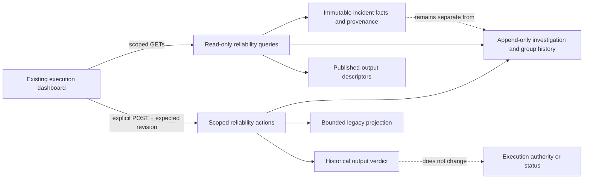

# R5a Incident Intelligence dashboard contract

R5a adds a browser client for the existing `/api/reliability` service. The
service owns scope validation, incident provenance, append-only writes and
current-revision checks. This UI contract describes the authored integration;
its actual verification and remaining mission limits are recorded in
[implementation-progress.md](implementation-progress.md).

## Scope and authority

Every request identifies one actual task. Cross-execution history uses
`{"task":"<task-id>"}`. A selected execution uses the complete tuple
`{"task":"<task-id>","execution":"<execution-id>","epoch":"<epoch-id>"}`;
execution and epoch are paired. Legacy projection, published-output browsing
and output verdicts require the full tuple. The server checks task ownership
and repository scope.

The dashboard attributes local human actions as `local_dashboard_operator`.
That label is not named-user authentication, approval or a runtime capability.
Investigations and group decisions never alter immutable incident facts or
execution status.

## Reads

All reads return a versioned envelope with the validated scope and coverage.
They are read-only; a missing store is not initialized by a GET.

| Route | Use | Bounded navigation |
| --- | --- | --- |
| `GET /api/reliability/incidents` | Search canonical incidents by literal `q`, category and source kind. | 25 by default, at most 100. `before_time` and `before_id` are paired. `next_cursor` contains `created_at` and `incident_id`; pass these as `before_time` and `before_id`. |
| `GET /api/reliability/detail?incident=…` | Read one immutable fact, closed source-provenance descriptor and current investigation view. | Requires incident ID and task scope. |
| `GET /api/reliability/investigation?incident=…` | Read append-only investigation revisions. | 25 by default, at most 100; use `next_revision` as `before_revision`. |
| `GET /api/reliability/groups` | Read persisted related-symptom suggestions. This does not create suggestions. | 25 by default, at most 100; time/ID cursor fields are paired. |
| `GET /api/reliability/group?group=…` | Read one same-scope group and its decision history. | 25 by default, at most 100; use `next_revision` as `before_revision`. |
| `GET /api/reliability/projection` | Read legacy-index coverage as of the current checkpoint. | Full task/execution/epoch tuple required. |
| `GET /api/reliability/outputs` | Read metadata-only descriptors for actual published outputs in the selected epoch. | 25 by default, at most 100; pass `next_cursor.before_id` as `before_id`. |

Incident search is literal and limited to safe incident ID, category, symptom
code and source-kind fields. It is not report/log full-text search. A
`legacy_unindexed` incident is visible but read-only until the operator
explicitly projects it in a selected epoch. Projection processes at most 100
rows per request and is an as-of checkpoint, not a permanent coverage claim.

Output descriptors include IDs, digest, name, owner, role, size and graph
revision. The dashboard does not read arbitrary paths or output bytes. The
verdict POST revalidates the selected immutable descriptor independently.

## Append-only actions

All POST bodies include `schema_version: 1` and the actual `scope`.

| Route | Required fields | Effect |
| --- | --- | --- |
| `POST /api/reliability/investigate` | `incident`, `expected_revision`, `request_id`, `changes` | Appends an attributed investigation revision. Exact replay is idempotent; changed replay or stale revision returns conflict. |
| `POST /api/reliability/suggest` | `limit`, optional bounded `cursor` | Computes suggestions for one bounded incident window; it is not global similarity search. |
| `POST /api/reliability/group-decision` | `group`, `expected_revision`, `request_id`, `decision` | Appends accept/reject/split/supersede. Split must partition every member once; supersede targets another actual same-scope group. |
| `POST /api/reliability/project` | `expected_revision`, `request_id`, `limit` | Explicitly indexes up to 100 currently unindexed legacy rows. Requires full scope. |
| `POST /api/reliability/verdict` | `request_id`, immutable `{artifact_id,sha256}` target, rationale | Records a historical operator verdict against a published output. Requires full scope and does not change execution state. |

The investigation editor separates status, rationale/evidence, hypotheses,
controls, affected components, corrective-action suggestions and corrections.
Optional additions are explicit: a status-only edit does not silently append a
control or action. Evidence choices are actual incidents in the active scope;
task scope can reference incidents from different executions. Resolved and
dismissed statuses require newly supplied evidence. A non-unknown hypothesis
requires supporting evidence. Held/failed controls require evidence; generic
dispatch rejection remains unknown.

Confidence values are ordinal, not probabilities. Related symptoms do not
establish a shared cause. A verified component reference means only that an
existing unpurged Knowledge source/version belongs to the selected historical
snapshot. It does not verify current files, establish causation, or qualify a
native/provider boundary. Rejected text and raw output bytes are not displayed.

## Request boundaries

The dashboard uses the existing exact Host/same-origin JSON boundary. Unknown
or duplicate query fields are rejected. POST bodies are bounded before read;
the service accepts only known routes and fields. Conflict and validation
messages are fixed safe text. A 409 requires reloading the current incident or
group before editing again. Storage failures do not expose exception text.

The client keeps list, detail, revision, group and output state separately per
task/scope, guards late responses, retains user input/focus across panel refresh,
and leaves execution-scoped projection and verdict controls unavailable in
task-only scope.

## Current and downstream boundaries

The accepted source kinds are operation dispatch, AL test result, AL review
finding, contract rejection, budget decision and operator verdict. R7's
evaluation-result adapter and R5b's standalone-AL ingestion remain separate
future work. Hosted CI, current mutable-source qualification, native/provider
qualification, full process-tree settlement, formal AL review/approval and
remaining R5b/R6–R11 mission work are not established by this UI contract.
